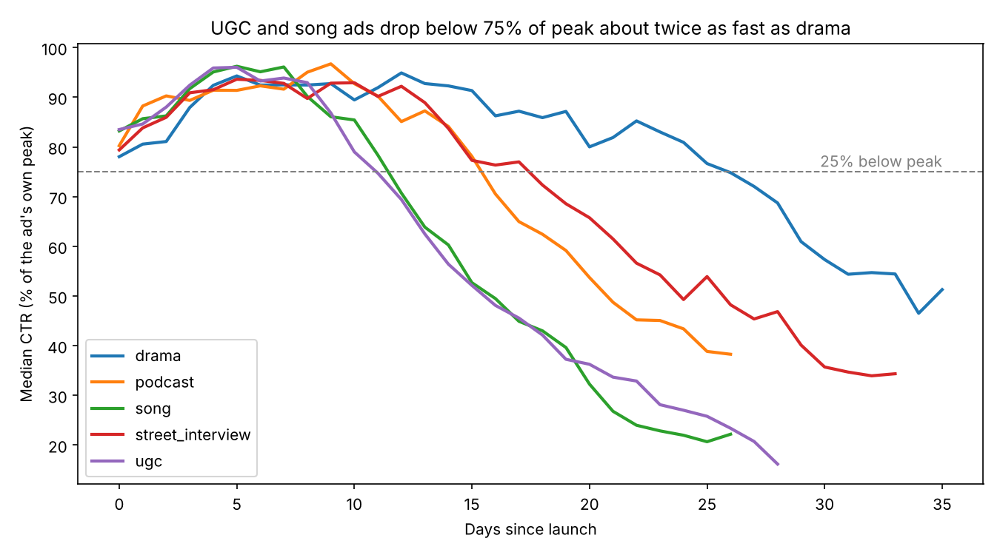
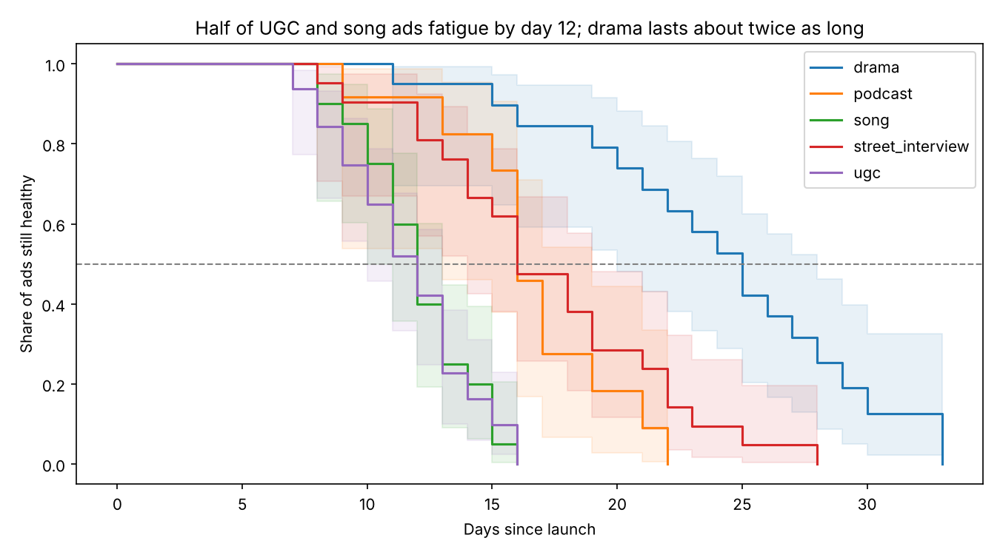
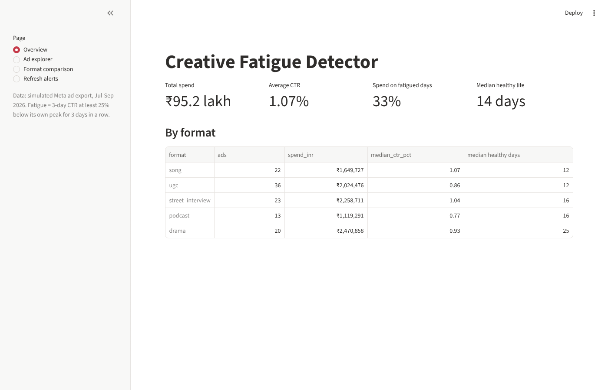
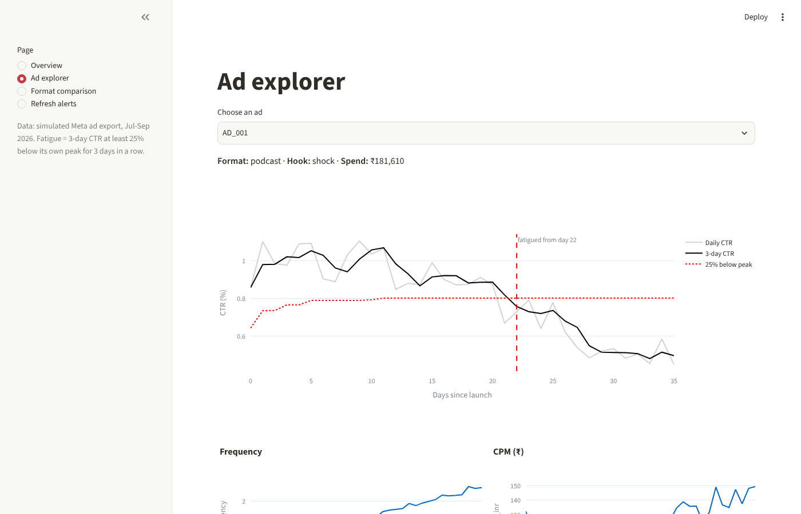
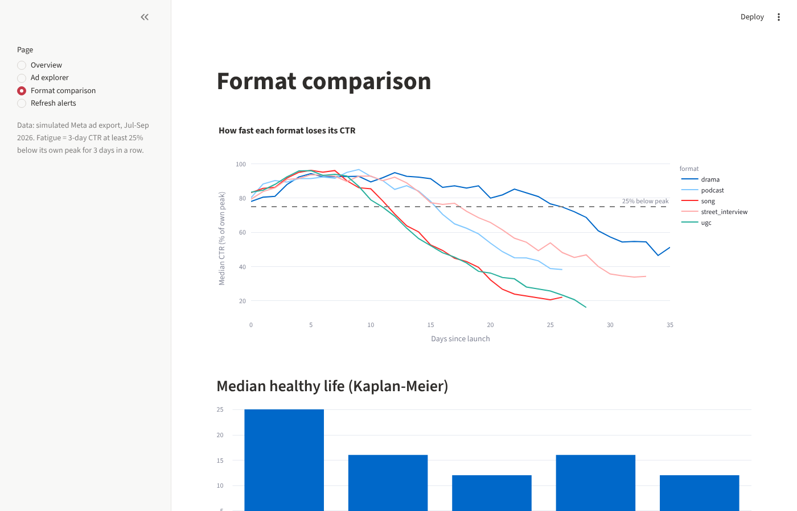
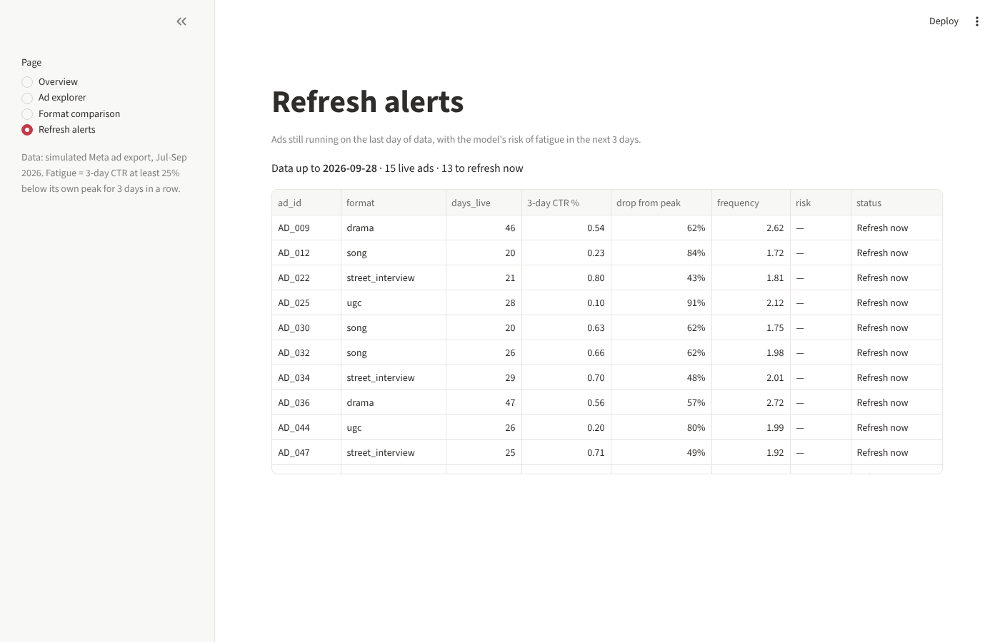

# Creative Fatigue Detector

**When does a Meta ad stop working?** This project finds the day each ad "burns out", measures how much budget is spent after that point, and turns the answer into a simple refresh rule and a dashboard a media buyer can check every morning.

> Data note: the dataset is **simulated** (120 ads, 90 days) because real ad accounts are client-confidential. The simulator's assumptions are documented in `src/simulate_data.py`. Every other script runs unchanged on a real Ads Manager export with the same columns.

## Key results

| Finding | Result |
| --- | --- |
| Spend on ads after they had fatigued | **33%** of ₹95.2 lakh |
| Median healthy life (Kaplan-Meier) | UGC & song **12 days** · street interview & podcast 16 · drama **25** |
| Cost per purchase before vs after fatigue | ₹261 → ₹667 (about **2.5×**) |
| Extra cost avoidable with a 25% refresh rule | **₹13.4 lakh** (14% of spend) |
| 3-day-ahead fatigue warning (logistic regression) | ROC-AUC **0.91**, recall 0.89 |
| Statistical change point vs 25% rule | Median gap **0 days** (they agree) |





## The refresh rule

> Refresh an ad the morning after its **3-day CTR has stayed at least 25% below its own peak for 3 days in a row.**

Sensitivity check (`reports/rule_sensitivity.csv`):

| Threshold | Ads flagged | Median detect day | Extra cost | Share of spend |
| --- | --- | --- | --- | --- |
| 15% | 102 | 14 | ₹15.7 lakh | 16.5% |
| **25%** | **100** | **16** | **₹13.4 lakh** | **14.1%** |
| 35% | 92 | 17.5 | ₹10.3 lakh | 10.8% |

*Extra cost = spend after detection − (purchases after detection × the ad's healthy CPA).*

## How to run

```bash
python3 -m venv .venv && source .venv/bin/activate
pip install -r requirements.txt

python src/simulate_data.py        # 1. create data/raw/ad_daily_raw.csv
python src/build_dataset.py        # 2. SQL cleaning + features -> data/processed/
streamlit run app/dashboard.py     # 3. open the dashboard
```

Then open the notebooks in `notebooks/` in order (01 → 04) and choose the `.venv` kernel.

To use a **real export**, rename its columns to match the raw file and run `python src/build_dataset.py path/to/export.csv`.

## Project structure

```
creative-fatigue-detector/
├── data/
│   ├── raw/ad_daily_raw.csv           # simulated Ads Manager export
│   └── processed/                     # cleaned + feature tables, cleaning log
├── sql/
│   ├── 01_clean.sql                   # dedupe, drop undelivered days, recompute ratios
│   └── 02_features.sql                # window functions, fatigue label, model target
├── src/
│   ├── simulate_data.py
│   └── build_dataset.py               # runs the SQL pipeline in SQLite
├── notebooks/
│   ├── 01_eda.ipynb
│   ├── 02_decay_and_changepoints.ipynb
│   ├── 03_survival.ipynb
│   └── 04_model_and_rule.ipynb
├── app/dashboard.py                   # Streamlit, 4 pages
└── reports/
    ├── figures/
    ├── rule_sensitivity.csv
    └── business_memo.md / .pdf
```

## Method

1. **Cleaning (SQL):** removed 28 duplicate rows, 14 zero-delivery days and 6 test ads with under 3 days of data (`data/processed/cleaning_log.csv`). CTR and CPM are recomputed from raw counts.
2. **Features (SQL window functions):** 3-day rolling CTR, peak-to-date, % drop from peak, CTR slope, CPM vs launch, days live.
3. **Fatigue label:** 3-day CTR ≥ 25% below its own peak for 3 delivered days in a row.
4. **Decay curves:** each ad normalised to its own peak; median per format.
5. **Change-point detection:** `ruptures` (PELT) finds each ad's downward break as an independent check of the rule.
6. **Survival analysis:** Kaplan-Meier with censoring (ads paused early or still running), log-rank test across formats.
7. **Prediction:** logistic regression vs random forest predicting fatigue in the next 3 days, with a **date-based** train/test split.
8. **Business rule:** extra-cost estimate and a 15 / 25 / 35% sensitivity check.

## Dashboard

| Overview | Ad explorer |
| --- | --- |
|  |  |
| **Format comparison** | **Refresh alerts** |
|  |  |

## Limitations

- **Simulated data:** results reflect the simulator's assumptions; the method needs a real export to produce real insights.
- **Threshold choice:** 25% is a business assumption, tested at 15% and 35%.
- **Outside events:** sales, festivals or audience changes can also move CTR.
- **Simulated ads never recover** once they decay; real ads sometimes bounce back, which would favour a less aggressive threshold.
- **Model evaluation:** the same ad can appear in both train and test sets; a stricter test would also split by ad.

## Tools

Python · pandas · SQLite (SQL window functions) · matplotlib · Plotly · ruptures · lifelines · scikit-learn · Streamlit
